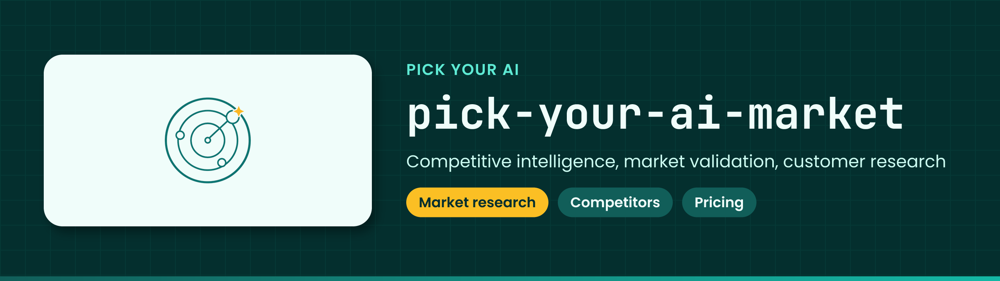

<!-- showcase:banner:start -->

  

<!-- showcase:banner:end -->

<!-- showcase:nav:start -->
**Pick Your AI** · [All repositories](https://github.com/Pick-Your-AI) · [Contributing](CONTRIBUTING.md) · [Security](https://github.com/Pick-Your-AI/.github/blob/main/SECURITY.md)
<!-- showcase:nav:end -->

# Pick Your AI — Market & Competitive Intelligence

<!-- showcase:badges:start -->

<!-- showcase:badges:end -->

<!-- showcase:tagline:start -->
**Competitive intelligence, market validation, customer research, and product differentiation for Pick Your AI, the PCPartPicker for AI.**
<!-- showcase:tagline:end -->

---

## About

Research demand, competitors, positioning, commercial models and product differentiation for Pick Your AI.

This repository is the home for **new market research**. [Project #2](https://github.com/orgs/Pick-Your-AI/projects/2) coordinates both this repository and existing work in [pick-your-ai-research](https://github.com/Pick-Your-AI/pick-your-ai-research).

## Notes

### Start here

- Check [Project #2](https://github.com/orgs/Pick-Your-AI/projects/2) and [the existing market program](https://github.com/Pick-Your-AI/pick-your-ai-research/issues/47) before creating work.
- Follow [CONTRIBUTING.md](CONTRIBUTING.md) for evidence, ownership and review requirements.
- Coordinate with [Market & Competitive Intelligence](https://github.com/orgs/Pick-Your-AI/teams/market-competitive-intelligence) and [Lead Maintainers - Market & Competitive Intelligence](https://github.com/orgs/Pick-Your-AI/teams/lead-maintainers-market-competitive-intelligence). Issue assignees, rather than team membership, identify accepted work owners.

### Research areas

| Area | Scope |
| --- | --- |
| Competitors & Positioning | Source-linked competitor landscape, comparisons and positioning. |
| Customers & Demand | User problems, customer research, personas and demand evidence. |
| Pricing & Business Models | Commercial comparisons, business models and monetization evidence. |
| Product Strategy & Validation | Product scope, differentiation, feasibility and validation of hypotheses. |

Technical component selection, compatibility rules, technical pricebooks and the frozen v1 contracts remain in [pick-your-ai-research](https://github.com/Pick-Your-AI/pick-your-ai-research). Acquisition, normalization and publishing mechanics belong to [Catalog Pipeline](https://github.com/Pick-Your-AI/pick-your-ai-catalog-pipeline). This repository records market evidence and decisions; it does not establish product capabilities or authorize implementation, spending, outreach or deployment.

### Existing work and historical evidence

At initialization, Project #2 contains 22 existing items in the Research repository. They remain there with their issue identities, discussions, assignees, labels, dependencies and Project fields intact. This initialization does not migrate or recreate them.

Prior work includes [Market Research Program #47](https://github.com/Pick-Your-AI/pick-your-ai-research/issues/47), [research PR #67](https://github.com/Pick-Your-AI/pick-your-ai-research/pull/67), [market research notes](https://github.com/Pick-Your-AI/pick-your-ai-research/tree/main/research/market) and [market methodology](https://github.com/Pick-Your-AI/pick-your-ai-research/tree/main/docs/market-research). Follow the current state of those records; a historical link does not imply that its evidence is current or all acceptance criteria are complete.

Continue work already tracked there in its existing issue. A future migration requires a separate agreed plan and verification. Keep Research linked to Project #2 until that transition is complete.

### Evidence and handoffs

Record primary source URLs, publisher, access date, relevant version/region, the supported claim, confidence and limitations. Distinguish published claims, independent measurements and estimates. Unknown means unknown; never invent missing prices, sources or measurements.

Document the question, method, findings, limitations and requested decision in each research submission. Link the receiving technical or product issue and obtain the relevant owner's acceptance before describing a handoff as complete.
